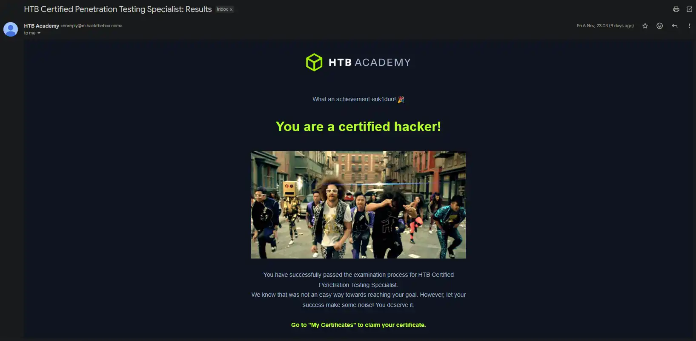
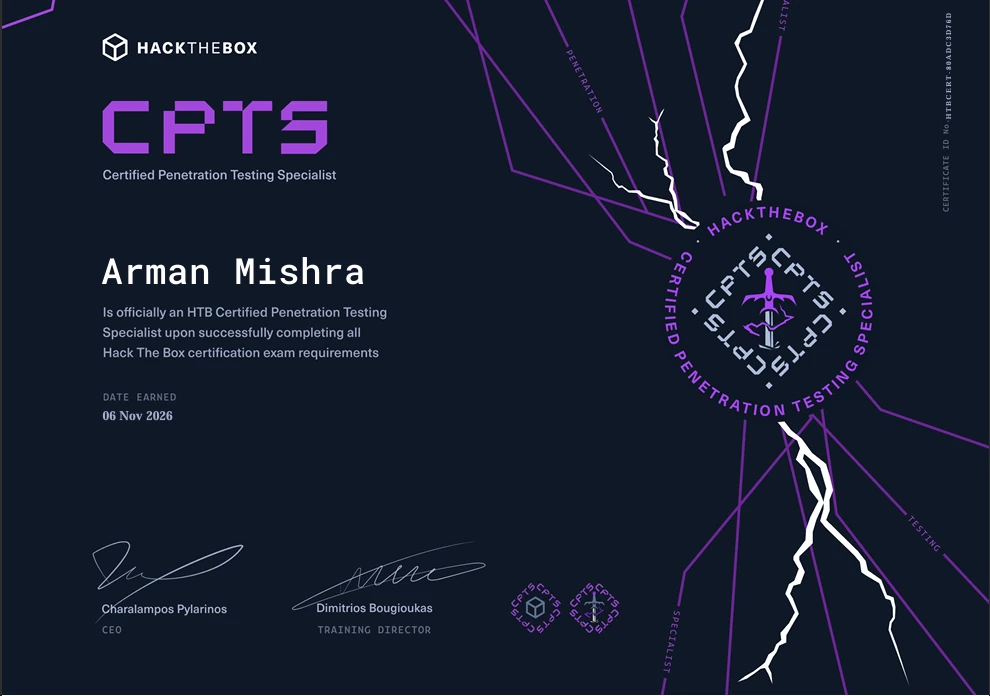
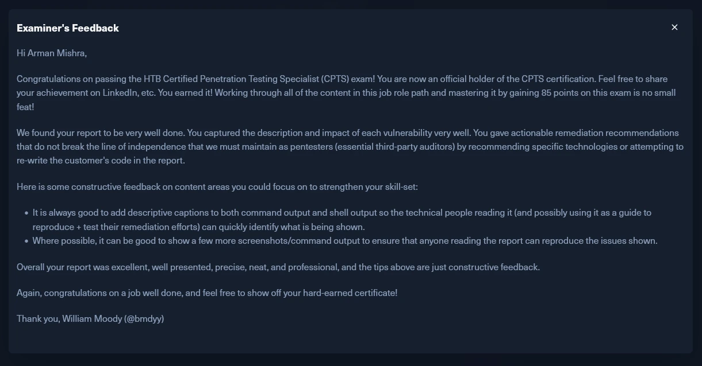

*Or how I spent several months preparing to hack things, accidentally deleted my own notes, and somehow ended up writing a 273-page book.*

So, I finally passed the Hack The Box Certified Penetration Testing Specialist (CPTS) exam!

I figured I'd write a little review about the entire experience: why I took it, how I prepared, how the exam went, the tools I used, and a few things I learned that might help someone preparing for it.

This isn't going to be some super-serious certification review. It's mostly me yapping about my experience, with some genuinely useful information sprinkled in here and there.

Also, this review is **spoiler-free**. No exam-specific attack paths, solutions, or infrastructure details.

Alright. Enough yapping about the yap. Let's get into it.

---

## 1. Why CPTS? (The Reason Is Stupider Than You Think)

I'd love to give you some elaborate explanation about career progression, professional development, and how I carefully evaluated every certification on the market before making an informed decision.

But the truth?

**I thought the certification looked cool.**

That's it. That's literally where it started. I saw the CPTS certificate, liked how it looked, and thought, "Yeah, I want that."

Not exactly the most sophisticated career decision, I know.

But jokes aside, there *was* some actual reasoning behind it.

I wanted a certification that would genuinely challenge my penetration testing skills, and CPTS seemed like one of the few reasonable alternatives to the OSCP.

Now, don't get me wrong, OSCP is a great certification, but have you SEEN the price tag?

Brother, that thing costs approximately one future child of mine, and I am rather fond of keeping both my kidneys.

I'd much rather spend my money on something that offers substantial technical depth without financially ruining myself in the process.

So yeah, the decision was a mixture of financial responsibility, genuine interest in penetration testing, and the monkey in my brain going:

**"OOGA BOOGA, COOL CERTIFICATE."**

And honestly? That's a pretty good summary of how this whole adventure began.

---

## 2. Preparation: The Great Notes Massacre

Now, this is where things get a little interesting.

When I first started the CPTS Academy path, I was actually being a responsible student for once. I spent around two months working through the modules, taking intricate notes, documenting techniques, commands, explanations, and pretty much everything I thought might come in handy later.

Since I didn't have an HTB subscription for the machines at the time, I supplemented my learning with equivalent TryHackMe rooms. The idea was simple: learn something from Academy, find something similar on THM, and get my hands dirty.

And honestly? It was working pretty well.

Then came summer break.

After two months of studying, I figured I'd earned myself a nice little break. You know, relax a little, touch some grass, maybe remember what sunlight looks like.

But apparently, I am physically incapable of leaving computers alone.

During the break, I got this random itch to try out another Linux distribution natively. Nothing particularly unusual. I had an external SSD lying around, so I thought I'd just format it, install the distro, mess around with it for a while, and call it a day.

Simple enough, right?

**Wrong.**

Somewhere during this brilliant operation, I managed to format my **D: drive instead of the external SSD.**

Yes.

The D: drive.

**THE DRIVE CONTAINING TWO MONTHS' WORTH OF CPTS NOTES.**

Gone. Reduced to atoms.

I just sat there contemplating my life choices. Two months of carefully documented enumeration techniques, exploitation methods, commands, and explanations, all sacrificed to the Linux gods because apparently reading disk labels is an optional skill.

The funniest part?

I was studying penetration testing, a field where you're supposed to be extremely careful about what you're targeting.

**AND I COULDN'T EVEN ENUMERATE MY OWN DRIVES PROPERLY.**

Enumeration is important, kids. Especially before formatting disks.

Anyway, after that little incident, I had to restart the Academy path from roughly halfway through.

And surprisingly, it wasn't nearly as painful as I'd expected.

What had initially taken me around two months to learn and document took roughly **three weeks** to go through again.

Turns out, despite deleting all my notes, I hadn't actually deleted the knowledge from my brain. Who would've thought?

In hindsight, that was probably one of the first moments I realised I was genuinely getting better at this stuff. The concepts were sticking, I was recognising attack patterns more quickly, and things that had previously taken me ages to understand were starting to feel almost natural.

So, accidental data destruction aside, I guess that was a pretty good sign.

### What I Actually Used to Prepare

Once I'd recovered from my brief career as a professional data destroyer, my preparation was fairly straightforward.

**The CPTS Academy Path**

This was the foundation of everything. I worked through the modules, learned the techniques, practiced the exercises, and tried to understand *why* things worked instead of simply memorising commands.

**The HTB CPTS Track**

After Academy, I worked through the CPTS Track machines to put what I'd learned into practice. It's one thing to understand an attack when a module is practically holding your hand, and another to figure out what to do when nobody tells you where to look.

**IppSec**

I also watched IppSec here and there. His videos are genuinely good material, especially for understanding approaches to enumeration, exploitation, and the thought process behind solving machines. I wouldn't say I religiously watched every video, but whenever I did, there was usually something useful to pick up.

**Dante Pro Lab**

For practicing in a network environment, I went with Dante.

Individual machines are great, but I wanted to get comfortable with something closer to a network assessment, where multiple systems are involved and compromising one machine doesn't necessarily mean you're finished. Dante gave me an opportunity to approach a network as a whole rather than treating every target as an isolated puzzle.

And that was pretty much my preparation.

No secret formula. No magical collection of 700 tools. Just studying the material, practicing what I'd learned, making mistakes, and gradually getting better at recognising what was happening in front of me.

Oh, and one final piece of advice:

**BACK. UP. YOUR. NOTES.**

Preferably somewhere that isn't one incorrectly selected disk away from becoming a character development arc.

---

## 3. Am I Ready? Am I Ready? AM I READY?

Now, here's something I haven't mentioned yet.

**I was absolutely SHIT SCARED of the exam.**

Not even exaggerating.

Despite finishing the Academy path and practicing on machines and networks, I kept questioning whether I was actually prepared.

*Should I root a few more boxes?*

*Should I go through my notes again?*

*What if I forgot something important?*

*What if I spend all that money just to get absolutely folded by the exam?*

You get the idea.

I have ADHD, and sitting still while my brain runs through approximately 47 different possibilities isn't exactly my strongest skill.

At some point, I realised I could probably spend another month preparing and still find something to worry about.

So I decided to just dive in.

But not before spending **TWO WHOLE DAYS PREPARING MY LINUX VM.**

Two days.

Forty-eight hours of my life.

Doing what, exactly?

I DON'T KNOW.

I use Parrot OS. It already comes with pretty much everything you need to get started.

But there I was, installing tools, organising directories, tweaking configurations, checking scripts, and doing approximately everything except starting the actual exam.

At some point, I think I was just doing things for the sake of doing things.

Procrastination, but make it cybersecurity.

To be fair, I did end up with a pretty neat and personalised toolkit, including some tools I'd built myself. More on those later.

And eventually, with my VM prepared, my notes ready, and my brain still questioning every decision I'd ever made...

**I started the exam.**

---

## 4. The Exam: Four Days of Questionable Decisions

So, how long did it take?

About four active days of hacking, with the entire experience, including final reporting and submission, wrapping up in roughly **4.5 to 5 days**.

Which, looking back, was surprisingly quick.

I genuinely don't know how I managed that, but here's how it went.

### Day 1: One Flag and the 9-to-5 Massacre

**Flags captured: 1**

Day one was... messy.

I managed to capture exactly one flag.

ONE.

Now, in my defence, I had college that day.

So imagine spending your entire day enduring the glorious 9-to-5 massacre that is college, coming home, and deciding that the best way to relax is to spend another six hours staring at a terminal.

Absolutely brilliant decision-making.

I spent those six hours working through the environment, enumerating, trying to understand what I was dealing with, and eventually getting that first flag.

And then I stopped. Not because I wanted to, but because I was exhausted and desperately needed sleep.

So yeah, day one wasn't exactly a grand display of hacking excellence.

But hey, one flag is better than zero.

**Day 1 total: 1 flag.**

### Day 2: Four Flags and a Humbling Experience

**Flags captured: 4**

Now THIS was a much better day.

I managed to get flags two and three relatively smoothly.

Things were moving along, I was feeling good, and I was starting to think I had a decent handle on the environment.

And then...

**A WALL.**

A big, beautiful, absolutely infuriating wall.

I spent a ridiculous amount of time trying to figure out how to proceed. I was thinking of complicated approaches, exploring different possibilities, and generally convincing myself that the solution had to involve something clever.

It did not.

The solution was so stupidly simple that I genuinely questioned my intelligence for a moment.

Turns out, sometimes you need to stop trying to be the smartest person in the room and just **dumb things down a little.**

And wouldn't you know it?

IT WORKED.

Flags four and five followed shortly after.

The lesson here is simple: when you're stuck, don't automatically assume that you need some obscure technique or elaborate exploit chain. Sometimes you just need to revisit the basics and look at what's already in front of you.

After that, I spent some time updating my report, documenting what I'd done, and making sure I wasn't accumulating a mountain of reporting work for later.

Then I went to sleep.

**Day 2 total: 5 flags.**

### Day 3: The Comeback Arc

**Flags captured: 4**

Day three was probably my favourite day of the entire exam.

Things were going GREAT.

I managed to capture another four flags, bringing my total up to nine. For the first time, I could actually see the finish line.

Not that everything went smoothly.

**Flag eight nearly took my soul.**

I got properly stuck on that one. Eventually something clicked: there was a technique I'd picked up while preparing for my PJPT certification that I remembered could be useful.

So I tried it.

And it WORKED.

Sometimes, the most valuable thing you bring into an exam isn't a tool or a cheat sheet. It's some random piece of knowledge you picked up months ago that suddenly becomes relevant.

Also, shoutout to **Heath Adams**.

The man is the GOAT. Genuinely.

With nine flags secured, I decided to spend some serious time on my report. I still had plenty of time left, and the last thing I wanted was to rush the most important deliverable.

So I started stitching everything together, reviewing findings, organising screenshots, and making sure the technical details were properly documented.

Things were looking pretty good.

Which obviously meant something had to go wrong.

**Day 3 total: 9 flags.**

### Day 4: Ohio Networking and the Final Three Flags

**Flags captured: 3**

Ah, day four.

The day my networking decided it had simply had enough.

By this point, I'd been working through a network environment with multiple pivots. And if you've ever worked with double pivots, you'll know that things can get a little... interesting.

Well, I managed to completely screw up my network configuration.

**I DESTROYED MY PIVOTS, OHIO STYLE.**

The routes were a mess, my pivoting setup wasn't cooperating, and I eventually had to reset and rebuild the network configuration.

Wonderful.

Absolutely wonderful.

Nothing quite like spending days carefully establishing access paths only to watch your networking setup collapse like a house of cards.

I did manage to recover and capture another three flags, bringing my total to **12 flags**.

At that point, I'd had enough.

I was satisfied with the progress, and although I still had time available, I didn't particularly feel like gambling my remaining sanity on a network that clearly wanted me dead.

So I stopped there.

Twelve flags.

And now came the real final boss.

**THE REPORT.**

Across the exam, I ended up spending approximately **20 hours** polishing and finalising that thing.

Checking screenshots, verifying steps, reviewing findings, fixing formatting, making sure my attack paths were understandable, and generally trying to turn several days of hacking into something a human being could actually read.

When I was finally satisfied, I submitted it.

And then came the waiting.

About 20 hours after submitting my report, I received the email.

**I PASSED.**

85 points.

CPTS CERTIFIED.

**I HAD SLAIN THE DRAGON.**

After all the preparation, the destroyed notes, the late nights, the networking disasters, and the 273-page report, it was finally over.

And man, did that feel good.

*The email that made the whole ordeal worth it.*

And here it is, the certification that started this whole adventure simply because I thought it looked cool.

*Worth it.*

---

## 5. So, How Difficult Is CPTS?

I would say CPTS is **fairly difficult**.

There are moments when the exam makes you feel completely stranded. You'll be staring at your terminal, looking through your notes, wondering whether you've missed something obvious or whether the exam has finally decided to put you out of your misery.

But here's the thing.

**I think CPTS is a FAIR exam.**

And I really want to emphasise that word.

*Fair.*

It's not an exam where you need to know some ridiculously obscure technique that was never covered in your preparation. Nor is it an exam where memorising a bunch of commands will magically carry you through.

It tests whether you actually understand what you've learned and whether you can apply that knowledge when nobody is telling you what to do next.

If you've worked through the Academy path properly, understood the material, and practiced applying the concepts in different environments, you should have the foundation needed to tackle it.

That doesn't mean you're guaranteed to pass. It means the exam gives you a reasonable opportunity to succeed with the knowledge you've been taught.

And that's something I genuinely appreciate.

One thing I would strongly recommend is to **focus on enumeration**.

I cannot stress this enough.

Don't rush into exploitation just because you've found something that looks interesting.

Enumerate your targets, understand the services you're dealing with, document what you've discovered, and follow the evidence.

If something isn't working, revisit your assumptions.

Sometimes the answer isn't a new exploit.

Sometimes you just haven't enumerated enough.

And yes, I am aware of the irony of me saying this after accidentally formatting the wrong drive.

Character development, I suppose.

---

## 6. The Toolkit: My Little Arsenal

I spent two days preparing my Parrot OS VM, so I might as well justify those 48 hours of my life.

Over time, I've built a personalised environment for network enumeration, Active Directory assessments, credential management, and pivoting.

These were the mainstays of my exam toolkit, alongside utilities I kept ready when needed.

### Network Discovery and Enumeration

- **RustScan:** Fast port discovery. I like finding open ports without spending an eternity staring at a terminal.
- **Nmap:** Service fingerprinting, enumeration, and NSE scripts. The classics never disappoint.
- **[Shredder](https://github.com/enkidudev/shredder):** My own scanner, built around fast discovery, service enumeration, and evidence-based triage.

### Active Directory and Windows

- **RustHound CE and BloodHound CE:** Collecting and visualising Active Directory relationships and potential attack paths.
- **NetExec:** One of my favourite tools for Windows network and Active Directory assessments.
- **Impacket:** An excellent collection of Python tools for working with Windows services and protocols.
- **BloodyAD:** Working with Active Directory objects and their permissions.
- **Certipy:** AD CS enumeration and assessment.
- **Evil-WinRM:** Remote PowerShell access where applicable.

### Credential Handling and Other Utilities

- **Hashcat and John the Ripper:** Password and hash cracking when needed.
- **Netcat:** Simple, reliable, and ridiculously useful.
- **INK:** Another tool I built myself, primarily for keeping track of credentials, hashes, usernames, and notes throughout an assessment.

### Pivoting

- **Ligolo-ng:** My preferred pivoting tool.

I absolutely love Ligolo-ng.

When it works, it's beautiful.

When your double pivot decides to implode, however, you may briefly reconsider your career choices.

Looking at you, day four.

Obviously, tools are only part of the process. You can install every offensive security tool known to humanity and still spend six hours staring at a problem because you missed something embarrassingly simple.

Trust me. I have experience.

**Build a toolkit you're comfortable with.** You don't need every tool under the sun. You need to understand what your tools do, when they're useful, and how to troubleshoot things when they refuse to cooperate.

---

## 7. Reporting: The Actual Final Boss

I received some pretty positive feedback on my CPTS report, so I figured I'd share a thing or two.

*The examiner's feedback on my submission.*

The examiners described my report as **"excellent, well presented, precise, neat, and professional."**

They appreciated the vulnerability descriptions, explanations of impact, and actionable remediation recommendations that maintained the independence expected of a third-party assessor.

There were also a couple of suggestions for improvement: add more descriptive captions to command and shell outputs, and include more supporting screenshots or command output where they help readers reproduce the findings.

Fair points. And things I'll definitely carry forward.

Now, I don't want to reinvent the wheel here.

If you're preparing for CPTS, I'd strongly recommend reading **[Bruno Rocha Moura's CPTS reporting guide](https://www.brunorochamoura.com/posts/cpts-report/)**.

I read it myself, and it's a genuinely useful resource for structuring your reporting workflow.

But I also wanted to share a few things I've picked up from my own experience.

### Screenshots: Greenshot Is Your Friend

For capturing screenshots, I used **Greenshot**.

Simple tool. Does the job. Easy to edit screenshots without opening some enormous image-editing application every five minutes.

### Make Your Terminal Screenshots Readable

Here's a small thing I like doing.

**Invert or adjust your terminal screenshots so they're easier to read, and add borders where necessary.**

Depending on your terminal theme, some screenshots can be surprisingly difficult to read when embedded in a document.

You never know who is going to read your report, what device they'll be using, or whether they'll print it.

Something that looks perfectly readable on your monitor might look awful inside a PDF.

So make sure your screenshots are clear, have sufficient contrast, and stand out from the surrounding document.

### HIGHLIGHT THINGS. PLEASE.

Imagine opening a report and seeing a massive screenshot containing 60 lines of terminal output.

Somewhere in those 60 lines is the one piece of evidence that matters.

But where?

WHO KNOWS?

The reader is apparently supposed to develop supernatural vision and locate it themselves.

Don't do that.

**Point the reader towards what matters.**

A red rectangle, a yellow highlight, an arrow, whatever works.

If you're demonstrating a misconfiguration, highlight it. If you're showing that a command succeeded, highlight the relevant output. If you're proving a finding, make the evidence immediately visible.

Your screenshots should support your explanation, not become a Where's Waldo puzzle.

### REDACT. YOUR. SECRETS.

Passwords. Hashes. Tokens. Anything sensitive.

**REDACT THEM.**

Every. Single. Password.

I cannot emphasise this enough.

During my own reporting, I was probably a little excessive with redaction. I even censored a significant portion of the hashes I'd collected, including some that arguably didn't need to be hidden.

But honestly? I'd rather be overly careful than accidentally expose something sensitive.

And redaction doesn't just apply to screenshots. Check command outputs, code blocks, tables, appendices, and every other place credentials might appear.

### Document Everything From Step 0 to Step 100

This is probably my biggest reporting tip.

**DOCUMENT. EVERYTHING.**

Not just the interesting exploits. Not just the successful commands. Not just the part where you finally get a shell and feel like a Hollywood hacker.

Document how you got there.

What did you enumerate? What did you discover? Why did you investigate a particular service? What evidence supported your next step? How did one finding lead to another?

Could somebody else follow your report and reproduce your results?

That's the question you should keep asking yourself.

Obviously, your final report doesn't need to contain every failed experiment or every command you've ever typed. But the important steps, evidence, and reasoning should be there.

**As a penetration tester, your deliverable is the report.**

That's what the client actually receives.

You might have performed the most technically impressive assessment in the history of humanity, but if your report is incomprehensible, you've failed to communicate a significant part of its value.

The people reading it need to understand what you found, why it matters, how it was demonstrated, and what they should do about it.

So take your time. Make it readable. Make it reproducible. Make it useful.

### And How Long Was My Report?

Ah, yes. The report.

When I finally exported my CPTS report, I looked at the page count.

**273 PAGES.**

TWO HUNDRED AND SEVENTY-THREE.

**BROTHER, I WROTE A BOOK.**

I genuinely don't know how it happened.

I just kept taking screenshots.

Every important discovery? Screenshot.

Every meaningful step? Screenshot.

Every successful command? Screenshot.

Before I knew it, I'd apparently written the extended director's cut of my penetration test.

Now, before you imagine 273 pages of dense technical writing, don't worry.

A LOT of those pages were images.

Would I recommend making every report 273 pages long?

Absolutely not.

**Length doesn't automatically mean quality.**

In fact, one thing I'd like to improve is making future reports more concise without sacrificing important technical details.

But for this exam, I wanted to make sure the person reviewing my work had enough evidence to follow what I'd done.

And judging by the feedback, I think that worked out pretty well.

Although next time, I might try writing a report instead of accidentally publishing a textbook.

---

## 8. What I'd Do Differently

Looking back, there are definitely a few things I'd change.

First, I'd probably stop questioning whether I'm prepared every five minutes. There's always another machine you can root, another technique to review, and another tool to install. At some point, you have to trust the work you've already put in.

Second, I'd be more careful with my time and energy. Spending six hours on an exam after an entire day of college isn't exactly the smartest way to operate. Breaks, sleep, and a fresh mind make a difference.

Third, I'd treat pivot configurations a little more carefully. I think day four speaks for itself.

And finally, I'd continue improving my reporting workflow: more descriptive captions, clearer command-output labels, and better organisation of supporting evidence.

Oh, and perhaps the most important lesson of them all:

**CHECK WHICH DRIVE YOU'RE FORMATTING.**

PLEASE.

I BEG YOU.

---

## 9. Final Thoughts: Was CPTS Worth It?

For me?

**Absolutely.**

CPTS was a genuinely valuable learning experience.

The Academy path taught me a lot, the practice environments helped me apply that knowledge, and the exam forced me to bring everything together.

Not just exploitation, but enumeration, problem-solving, pivoting, note-taking, and reporting.

I appreciated how the exam rewarded understanding rather than simply memorising techniques.

There were difficult moments. Times when I felt stuck. Times I felt like a complete idiot. And times when something I'd learned months earlier suddenly clicked and made everything worthwhile.

But that's part of the experience.

If you're planning to attempt CPTS, my advice is pretty straightforward:

**Learn the Academy material properly. Practice what you learn. Enumerate thoroughly. Document your work. And don't neglect reporting.**

You don't need to know every tool or every exploit in existence.

You need to develop a methodology you trust and understand the fundamentals well enough to adapt when things don't go according to plan.

And most importantly, don't let the fear of not being ready stop you from ever attempting something.

I went into this exam genuinely terrified that I wasn't prepared.

I came out of it with 12 flags, an 85-point passing result, a 273-page monstrosity of a report, and a certification I originally wanted because it looked cool.

I'd call that a pretty decent outcome.

---

## 10. That's All, Folks!

And that's about it for my CPTS yap.

If you've somehow read all the way down here, congratulations. You've demonstrated the patience required to survive at least one of my reports.

If you've got any questions about the certification, preparation, tools, reporting, or anything else, feel free to reach out.

You can connect with me on [LinkedIn](https://www.linkedin.com/in/armanmishra/) or drop me an email at **contact@armanmishra.in**.

Although, fair warning, I might take a while to respond to emails.

So just message me on LinkedIn, you dummy.

Anyway, I'm going back into hibernation now.

**The dragon is dead.**

See ya!
